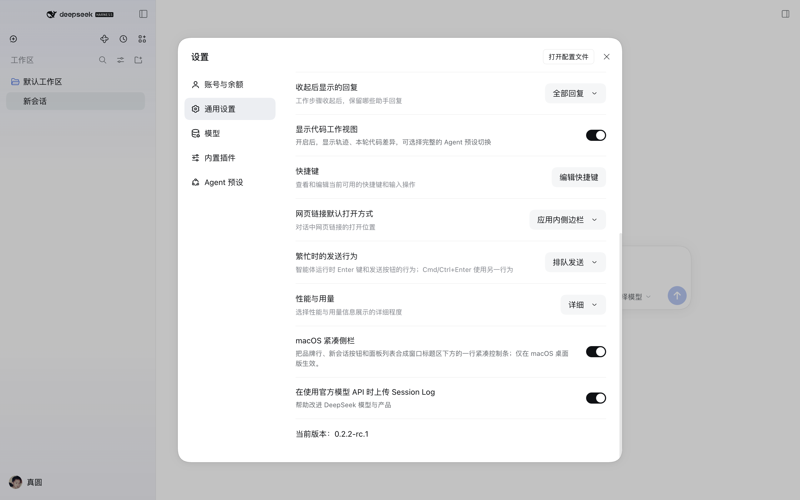

# dsh-macos-compact-chrome

A small, browser-only DSH plugin that gives the macOS Desktop sidebar a compact chrome.

On a laptop the stock sidebar spends most of its height above the session history: a 52px window strip, a 60px brand row, a full-width New Session bar, then one stacked row per global panel. This plugin folds those into one control row under the window strip, so the workspace and session history start about 170px higher.


*The stock sidebar (left, with the brand row, the full-width New Session bar and the stacked panel rows) compared with this plugin's compact chrome:*


The switch lives in **Settings → General**:



## Install

```sh
dsh plugin --profile desktop add github:SaltyAnt7342/dsh-macos-compact-chrome
```

or use the Plugins page in the app: **Add plugin → paste**
`https://github.com/SaltyAnt7342/dsh-macos-compact-chrome` and install.
Reload the window afterwards.

The npm package name `dsh-macos-compact-chrome` is reserved for a later
registry release; until then the GitHub repository is the install source.

The plugin is browser-only: no Host service, no tools, no network access, no configuration keys.

## Use

Open **Settings → General → Compact macOS sidebar** and switch it off to return to the stock rows. The choice is stored per browser profile in `localStorage['dsh-macos-compact-chrome']` (`on` / `off`, default `on`).

For an A/B check without the settings page, run this in the Web inspector and reload:

```js
localStorage['dsh-macos-compact-chrome'] = 'off'
```

## Scope and compatibility

- Applies only inside the macOS desktop shell (`html[data-platform='darwin']`); other platforms keep the stock layout.
- Applies only to the expanded sidebar; the collapsed 56px rail is untouched.
- The stylesheet is scoped to the stock expanded markup. A build or another plugin that already reshapes the sidebar (for example, a build that ships its own compact arrangement) makes the rules inert instead of breaking it.
- Tested with DeepSeek Harness `0.2.2-rc.1` on macOS arm64. The rules key off stable class tokens (`topStrip`, `logoRow`, `newSession`, `panelList`, `regionArea`, `footArea`) rather than generated class hashes, so a future sidebar rewrite should retire the stylesheet, not break the app.

## How it works

One `<style>` tag plus a `data-dsh-compact-chrome` marker on `<html>`:

1. The sidebar column becomes a 2-column grid: window strip on row 1, one control row on row 2, the content region on row 3, the foot on row 4.
2. The brand row becomes an absolute overlay inside the window strip, between the traffic lights and the window controls, with the wordmark scaled down to 15px.
3. The New Session button becomes a 36px icon button; the panel list becomes a right-aligned 36px icon row.
4. A Settings → General row owns the switch and persists it.

No DOM node is moved and no shipped component is imported.

## Known limitations

- The compact panel icons are icon-only; the shell disables hover tooltips in the expanded sidebar, so names are reachable through the accessible labels, not hover.
- The layout targets the macOS Desktop app. The browser tab on macOS also reports `data-platform="darwin"`, but has no traffic lights to clear; the result is still valid, slightly airier.
- If a future DSH release renames the sidebar's class tokens, the plugin stops applying (it fails inert) until the selectors are refreshed.

## Development

The plugin is plain ESM plus one browser module — no build step:

- `index.js` — Host half (no-op; the capability is client-side).
- `client.js` — browser module: preference store, stylesheet, Settings row.
- `cordis.patch.yml` — inserts the plugin row into the profile.
- `locale/en.json`, `locale/zh.json` — plugin-manager title and description.

To iterate, install the checkout directory as a bundle (`plugin_manager` install from the local path links it), edit `client.js`, then toggle the bundle off and on again from the Plugins page to reload the browser module.

## Source build

`tooling/` carries a second route: patch `ui-sidebar` sources and repackage the whole app. It produces a local unsigned DMG and ships the daily-check and rebuild-and-install scripts.

That route needs a local official source clone and a full build environment, so it suits long-term personal use; for appearance alone, install the plugin above. The patch, updater, and upstream PR drafts live in [`tooling/`](tooling/README.md); version history is in [CHANGELOG.md](CHANGELOG.md).

## License

MIT. Not affiliated with or endorsed by DeepSeek; DeepSeek Harness is MIT-licensed by DeepSeek.
