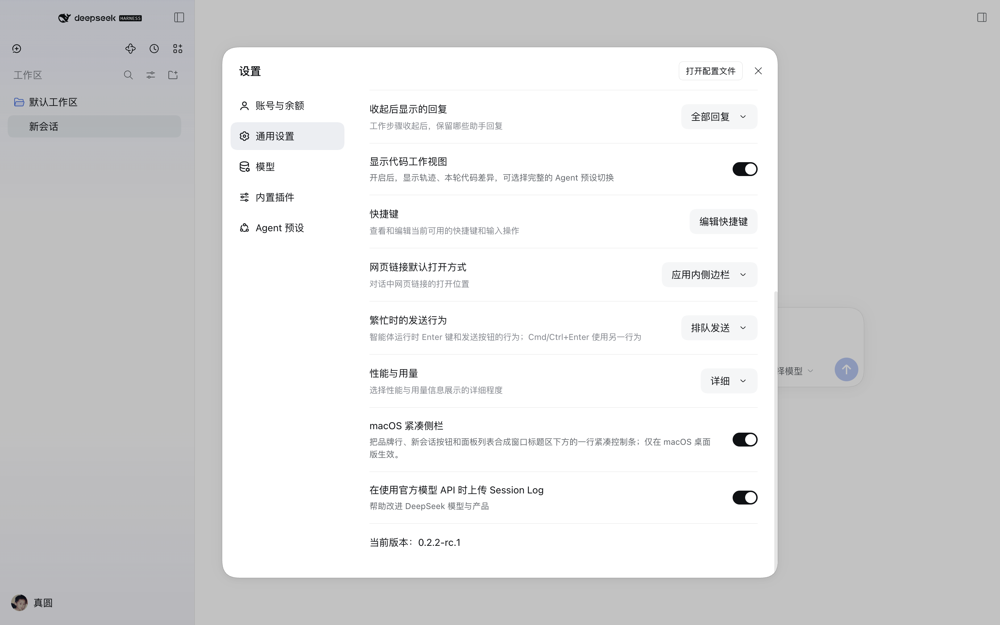

# dsh-macos-compact-chrome

一个纯浏览器侧的 DSH 插件：给 macOS 桌面版侧栏换上紧凑外观。

笔记本上，原版侧栏的会话历史被挤在很下面：52px 窗口条 + 60px 品牌行 + 整行「新会话」按钮 + 每个全局面板一行。这个插件把它们收进窗口标题区下方的一行控制条，让工作区/会话历史位置提前约 170px。


*原版侧栏（品牌行 + 整行「新会话」+ 竖排面板行）与本插件的紧凑外观对比：*


开关在 **设置 → 通用**：



## 安装

```sh
dsh plugin --profile desktop add dsh-macos-compact-chrome
```

或在应用的「插件」页里添加（添加插件 → 粘贴 `dsh-macos-compact-chrome`），然后重新加载窗口。

插件只在浏览器侧运行：没有 Host 服务、没有工具、不联网、没有配置项。

## 使用

打开 **设置 → 通用 → macOS 紧凑侧栏**，关掉开关即可回到原版布局。选择按浏览器 profile 保存在 `localStorage['dsh-macos-compact-chrome']`（`on` / `off`，默认 `on`）。

不想进设置页也可以做 A/B 对比：在 Web 检查器里执行下面这句再刷新：

```js
localStorage['dsh-macos-compact-chrome'] = 'off'
```

## 范围与兼容性

- 只在 macOS 桌面壳里生效（`html[data-platform='darwin']`），其它平台保持原版布局。
- 只在侧栏展开时生效，收起后的 56px 窄轨完全不动。
- 样式只匹配原版展开态的侧栏结构；如果某个构建或别的插件已经重排过侧栏（比如自带紧凑布局的构建），规则会自动失效，而不是把侧栏弄乱。
- 已在 DeepSeek Harness `0.2.2-rc.1`（macOS arm64）上验证。选择器基于稳定的类名 token（`topStrip`、`logoRow`、`newSession`、`panelList`、`regionArea`、`footArea`），不依赖构建哈希，所以未来侧栏重写时最多是样式失效，不会弄坏应用。

## 实现方式

一个 `<style>` 标签，加上 `<html>` 上的 `data-dsh-compact-chrome` 标记：

1. 侧栏列变成两列网格：第 1 行窗口条，第 2 行控制条，第 3 行内容区，第 4 行底部。
2. 品牌行变成窗口条里的绝对定位覆盖层，位于红绿灯与窗口控件之间，字标缩到 15px。
3. 「新会话」按钮变成 36px 图标按钮；面板列表变成右对齐的 36px 图标行。
4. 「设置 → 通用」里的一行负责开关并持久化。

不移动任何 DOM 节点，也不 import 任何官方组件。

## 已知限制

- 紧凑状态下面板图标只有图标；官方壳在展开态禁用了悬停提示，因此名称只能通过无障碍标签获得，鼠标悬停看不到。
- 布局针对 macOS 桌面应用；macOS 上的浏览器标签页也报告 `data-platform="darwin"`，但没有红绿灯需要避让，效果仍然可用，只是显得更空。
- 如果未来 DSH 版本改了侧栏的类名 token，插件会停止生效（自动失效），需要更新选择器。

## 开发

插件是纯 ESM + 一个浏览器模块，没有构建步骤：

- `index.js` — Host 半边（空实现，能力都在客户端）。
- `client.js` — 浏览器模块：偏好存储、样式表、设置行。
- `cordis.patch.yml` — 把插件行插入 profile。
- `locale/en.json`、`locale/zh.json` — 插件管理器里的标题与描述。

迭代方式：把本目录作为 bundle 安装（`plugin_manager` 从本地路径安装会软链目录），改 `client.js`，然后在「插件」页把该 bundle 关掉再打开，即可重新加载浏览器模块。

## 许可

MIT。与 DeepSeek 官方无隶属或背书关系；DeepSeek Harness 本身由 DeepSeek 以 MIT 许可发布。
